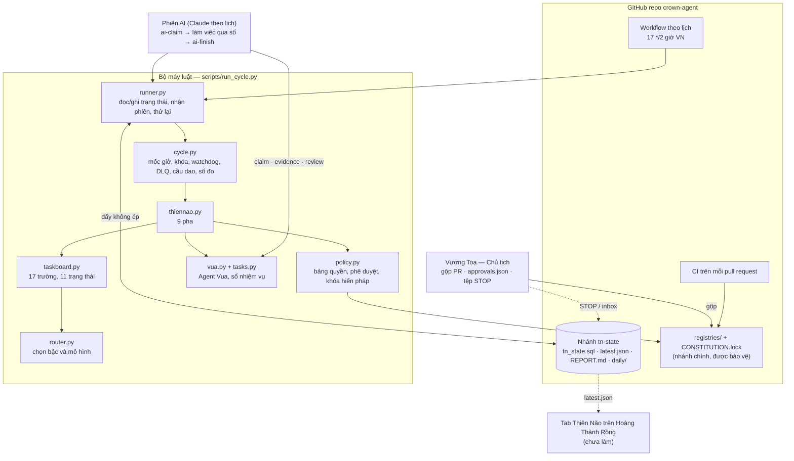

# D02 — KIẾN TRÚC (ARCHITECTURE BLUEPRINT) · Thiên Não Tối Thượng

- Phạm vi: Phase B (nền móng) của lệnh DRAGON SINGULARITY V1.0. Viết 06/11/2026, nhánh `thien-nao/phase-b`.
- Nhãn: **[KC]** đã kiểm chứng bằng test hoặc lệnh trong repo · **[MP]** mới chạy trong môi trường mô phỏng · **[ĐX]** đề xuất, chưa làm.
- Tài liệu đi kèm: `D03_PERMISSION_MATRIX.md` (bảng quyền, sinh từ dữ liệu), `AI_LANE_PROMPT.md` (lệnh cho phiên AI), `evidence/` (kết quả chạy thử).

## 1. Thiên Não là gì, ở mức mã

Thiên Não không phải một mô hình AI chạy liên tục. Nó là một **bộ máy luật** (Python thư viện chuẩn + SQLite) được đánh thức theo lịch, cộng với **các phiên Claude** được nó giao việc qua một sổ nhiệm vụ. Mọi quyết định có thể làm bằng luật thì không gọi AI.

- **Làn luật** (12 mốc/ngày, GitHub Actions, không AI): khôi phục → kiểm sức khỏe → lập kế hoạch → chọn mô hình → giao Agent Vua → làm việc bằng luật → kiểm → ghi bài học → báo cáo.
- **Làn AI** (4 mốc/ngày, tác vụ định kỳ Claude): nhận bản giao việc, làm việc đã giao qua sổ, người kiểm khác người làm, đóng phiên.
- Hai làn dùng chung **một khóa**: tại một thời điểm chỉ một phiên được ghi trạng thái.

## 2. Sơ đồ

## 3. Thành phần

| Thành phần | Tệp | Việc | Trạng thái |
|---|---|---|---|
| Sổ đăng ký Thiên Não | `registries/thien_nao.json`, `leaders.json`, `crown/registry.py` | Thiên Não trên Vua/CFO/CMO-01; 12 ghế TN (10 do A01–A20 giữ, 2 ghế mới TN-07, TN-12); 3 đơn vị (TN-ENGINE, A03-NB, A21-AT); lịch; ngân sách | [KC] `tests/test_thiennao_registry.py` |
| Bảng quyền D03 | `registries/permissions.json`, `approvals.json`, `CONSTITUTION.lock`, `crown/policy.py` | 3 loại hành động; phê duyệt riêng từng việc; không Agent nào tự nâng quyền; phát hiện tệp quyền bị đổi | [KC] `tests/test_policy.py` |
| Bộ phiên chạy D04 | `crown/cycle.py` | Mốc theo giờ Việt Nam; khóa + fencing token; chống lặp theo run_id; watchdog; thử lại có backoff và trần; dead-letter queue; chạy bù có trần; dừng khẩn cấp; cầu dao; số đo có khoảng tin cậy | [KC] `tests/test_cycle.py` |
| Trạng thái bền | `crown/statesync.py` | SQLite ↔ bản kết xuất văn bản trên nhánh `tn-state`; đẩy không ép (so-sánh-rồi-ghi); kiểm sha256; mỗi người ghi có dấu riêng | [KC] `tests/test_statesync.py` |
| Bảng nhiệm vụ D05 | `crown/taskboard.py` | 17 trường, 11 trạng thái của lệnh trên sổ nhiệm vụ có sẵn; không tạo trùng | [KC] `tests/test_taskboard.py` |
| Model router D06 (tối thiểu) | `registries/models.json`, `crown/router.py` | Bậc theo loại việc; mô hình chưa xác minh không được chọn; hết hạn mức thì việc thường hạ bậc, việc rủi ro cao CHỜ; luôn có dự phòng | [KC] `tests/test_router.py` |
| Chu trình 9 pha | `crown/thiennao.py` | Mục 4 | [KC] `tests/test_run_cycle.py` |
| Bộ chạy | `crown/runner.py`, `scripts/run_cycle.py` | Nối chu trình với nhánh trạng thái; làn luật và làn AI | [KC] `tests/test_run_cycle.py`, `test_run_cycle_cli.py` |
| Lịch và CI | `.github/workflows/thien-nao-cycle.yml`, `ci.yml` | 12 mốc/ngày; test + kiểm quyền trên mỗi PR; action ghim SHA | [KC] cú pháp và luật tĩnh (`tests/test_workflows.py`) · **chưa chạy trên GitHub thật** |
| Chạy thử an toàn | `scripts/tn_trial.py` | 13 mục kiểm trên "GitHub giả" | [MP] `evidence/TRIAL_2026-11-06.md` |

## 4. Một phiên làn luật

| Pha | Làm gì | Danh tính | Ghi lại |
|---|---|---|---|
| 01 WAKE & RECOVERY | Phiên chết → INTERRUPTED; mốc bị bỏ → MISSED kèm nguyên nhân; việc thất bại đủ thời gian chờ → xếp lại; hết lượt → hàng chờ người quyết | THIEN_NAO | bài học "incident" |
| 02 SYSTEM AUDIT | Sổ đăng ký, bảng quyền + khóa hiến pháp, sổ nhiệm vụ (integrity, nhật ký chỉ-thêm), lịch hai làn, bộ test. Web và tác vụ định kỳ: **SKIP có ghi lý do** (bộ máy luật không đọc được) | TN-ENGINE | `tn_health` |
| 03 PLANNING | Nhận hộp việc (`state/inbox.json`), sinh việc sửa lỗi từ kiểm sức khỏe (tối đa 1 việc/loại/ngày), báo cáo ngày, chọn tối đa 5 việc còn bước cho bộ máy làm | THIEN_NAO | bảng nhiệm vụ |
| 04 MODEL ASSIGNMENT | Mỗi việc một quyết định: mô hình, bậc, lý do theo 6 tiêu chí, dự phòng; hết hạn mức → CHỜ | THIEN_NAO | điểm kiểm + `tn_usage` |
| 05 DELEGATION | Việc của Agent → yêu cầu `TN-<mã>` cho Agent Vua, việc con S1 **chính là** việc trên bảng. Agent chưa kích hoạt hoặc phạm vi không được ủy nhiệm → BLOCKED | THIEN_NAO → VUA_CEO | `vua_requests` |
| 06 EXECUTION | Việc làm bằng luật (hiện có: báo cáo ngày) | TN-ENGINE | tệp + sha256 làm bằng chứng |
| 07 QUALITY CONTROL | Việc bằng luật: tính lại bằng SQL trực tiếp, so với tệp. Việc của Agent: chờ người kiểm độc lập ở làn AI; chấm điểm = mục kiểm đạt / tổng | THIEN_NAO | `QUALITY_SCORE` |
| 08 LEARNING | Lỗi, quyết định, việc chờ ngân sách → bản ghi có thời gian, nguồn, mức tin cậy, phiên bản | TN-ENGINE | `tn_lessons` |
| 09 REPORTING | `latest.json` (cho web), `REPORT.md` (cho người), báo cáo ngày | TN-ENGINE | nhánh `tn-state` |

Lỗi trong một pha: phiên ghi FAILED, chờ 60 rồi 120 giây, thử lại ngay trong cùng lượt chạy và **tiếp từ pha hỏng**, tối đa 3 lần. Sau 3 phiên hỏng liên tiếp cầu dao mở: phiên sau chỉ chạy pha 01, 02, 09 (chế độ an toàn); kiểm sức khỏe đạt thì phiên kế được thử đủ 9 pha.

## 5. Một phiên làn AI

1. `run_cycle.py ai-claim`: kiểm trần phiên AI/ngày → nhận khóa (40 phút) → trả **bản giao việc**: tối đa 3 việc đã giao, mỗi việc kèm ghế TN (chỉ thị, giới hạn, công cụ, bậc mô hình), mô hình đã chọn, mã yêu cầu của Agent Vua; danh sách luật cứng sinh từ bảng quyền; 10 bài học gần nhất.
2. Phiên Claude đóng vai Agent Vua, giao từng việc cho Agent con đúng mô hình, làm việc qua `python -m crown vua claim|evidence|move|review`. Sổ chặn tự duyệt.
3. `run_cycle.py ai-finish`: chấm điểm việc đã được duyệt, ghi kết quả, nhả khóa. Khóa hết hạn hoặc trạng thái trên kho đã bị bên khác ghi → **từ chối, không ghi đè**.

Bộ máy chưa bao giờ tự gọi một mô hình AI. Phần AI trong mọi lần chạy tới giờ là kịch bản đóng thế [MP].

## 6. Trạng thái và bộ nhớ

- **Một nguồn chuẩn**: database SQLite, lưu giữa các phiên thành `state/tn_state.sql` + `state/meta.json` (sha256) trên nhánh `tn-state`. Nhánh chính không bị đụng.
- **Ngắn hạn**: điểm kiểm từng pha của phiên (`tn_checkpoints`).
- **Dài hạn**: `tn_lessons` (mỗi bản ghi có thời gian, nguồn, mức tin cậy, phiên bản, khóa chống trùng), nhật ký sự kiện nhiệm vụ chỉ-thêm, báo cáo ngày.
- **Tổ chức**: yêu cầu Thiên Não → Agent Vua (`vua_requests`, `vua_steps`), ai làm, ai duyệt (`events`).
- Khi bắt đầu, phiên AI nhận việc chưa xong, luật cứng và bài học gần nhất — không nhận toàn bộ lịch sử.
- **Chưa có** [ĐX]: truy xuất theo mức liên quan, tóm tắt/gộp bài học, bộ nhớ riêng từng Agent (mới có vùng tên `memory_ns`), kho mục tiêu dài hạn.

## 7. Sáu bộ não ↔ mã

| Bộ não | Hiện thực | Mức |
|---|---|---|
| 01 Strategic | Chưa có kho mục tiêu, chưa có kế hoạch tuần/tháng/quý. Ghế TN-01 đã định nghĩa | [ĐX] |
| 02 Executive | Pha 03–05: việc → người làm → ưu tiên → hạn → tiêu chí | [KC] bằng luật |
| 03 Scientific | Chưa có. Ghế TN-12 đã định nghĩa | [ĐX] |
| 04 Memory | Mục 6 | một phần |
| 05 Engineering | Đường đi có sẵn (việc cho TN-04/TN-05 → làn AI → nhánh riêng → PR); chưa có lần chạy AI thật | [MP] |
| 06 Evolution | Chưa có. Số đo nền (mục 9) là điều kiện để bắt đầu | [ĐX] |

Kho trạng thái chung có lịch sử và bằng chứng: có (mục 6).

## 8. Chọn stack

Chọn **mở rộng lõi `crown` tự viết** làm khung điều phối chính; không tích hợp framework ngoài ở giai đoạn này.

| Phương án | Chi phí thêm | Độ phức tạp | Vì sao chưa chọn |
|---|---|---|---|
| Lõi `crown` + GitHub Actions + phiên Claude theo lịch (đã chọn) | 0 đồng; repo private dùng khoảng 360/2.000 phút Actions mỗi tháng (ước tính 12 phiên × ~1 phút) | Thấp: không gói ngoài, không máy chủ | — |
| LangGraph / Microsoft Agent Framework / OpenAI Agents SDK / CrewAI | Cần khóa API trả theo lượt + tiến trình chạy thường trực | Trung bình–cao | Chưa có khóa API (D-005, D-006); máy cloud không cài được gói; trùng vai với sổ nhiệm vụ đã có 250+ test |
| Temporal | Cần máy chủ Temporal | Cao | Quá nặng cho 12 phiên/ngày |
| LiteLLM | Cần ≥2 nhà cung cấp có khóa | Thấp | Hôm nay chỉ có Claude; `models.json` đã chừa chỗ cho GPT, Gemini, DeepSeek, Grok ở trạng thái NOT_CONNECTED |
| promptfoo / openevals / langfuse | Cần Node hoặc API hoặc máy chủ | Trung bình | Để Phase E khi có benchmark |

Điều kiện xem lại: có khóa API và ngân sách chi > 0, hoặc số việc vượt khả năng 4 phiên AI/ngày.

## 9. Độ tin cậy — đo gì, đo thế nào

- Đang đo [KC]: tỷ lệ mốc chạy thành công mỗi làn kèm **khoảng tin cậy Wilson 95%**; tỷ lệ khôi phục sau gián đoạn; số mốc bị bỏ kèm nguyên nhân; hàng chờ người quyết; trạng thái cầu dao; kết quả bộ test mỗi phiên.
- Cờ `target_9999_demonstrated` chỉ bật khi cận dưới khoảng tin cậy ≥ 99,99% — cần khoảng 30.000 lần chạy liên tiếp không lỗi. Với 12 phiên/ngày là nhiều năm, nên báo cáo luôn ghi "chưa" và con số thật.
- Chưa đo [ĐX]: task success rate, regression rate, deployment failure rate, cost per successful task, human intervention rate — cần việc thật chạy qua làn AI trước.
- Mốc bị dừng khẩn cấp không tính là lỗi nhưng không che các mốc bị bỏ trước nó.

## 10. Bảo mật

Chi tiết quyền ở D03. Các điểm thiết kế:

- **Quyền tối thiểu**: workflow không dùng secret; quyền duy nhất là `contents: write` để ghi nhánh trạng thái; CI chỉ đọc.
- **Chuỗi cung ứng**: không có gói ngoài; action duy nhất `actions/checkout` ghim SHA `3d3c42e5…` (v7.0.1, kiểm bằng `git ls-remote` 06/11/2026); test chặn mọi action chưa rà.
- **Chống chèn lệnh**: hộp việc chỉ lấy 11 trường đã biết, trường lạ bị bỏ; mỗi mục vẫn qua bảng quyền; việc chỉ-Chủ-tịch bị từ chối, việc nhạy cảm nằm ở BACKLOG tới khi có phê duyệt trên nhánh chính (Agent không ghi được nơi đó nếu nhánh chính được bảo vệ); bản giao việc cho AI kèm luật cứng.
- **Nhật ký**: sự kiện nhiệm vụ chỉ-thêm (trigger chặn sửa/xóa); lịch sử trạng thái là lịch sử commit của `tn-state`.
- **Dừng khẩn cấp**, **cầu dao**, **quay lại**: có (mục 4, D03 mục 9, mục 14 dưới đây).
- **Còn hở, cần cài đặt GitHub** (việc của Chủ tịch): bảo vệ nhánh chính; repo Private. Không có secrets manager vì chưa có secret nào; thực thi cô lập dựa vào máy chạy của GitHub và sandbox của Claude.

Rủi ro còn lại: mô tả việc trong hộp việc là văn bản tự do và sẽ được phiên AI đọc. Bảng quyền chặn được thao tác qua sổ, không chặn được mọi hành vi của một phiên AI có công cụ rộng. Giảm thiểu: phiên AI chỉ được cấp công cụ theo ghế, và người kiểm độc lập.

## 11. FinOps

- Mặc định 0 USD: mô hình trả theo API không bao giờ được chọn khi `usd_per_day = 0` [KC].
- Trần cứng do bộ máy thi hành: 4 phiên AI/ngày; 3 việc/phiên AI; lượt giao theo bậc mỗi ngày (FAST 12, BALANCED 8, CODING 4, ADVANCED 3); 5 việc/phiên luật; 25 phút/job.
- Việc làm được bằng luật không gọi AI (kiểm định kỳ, báo cáo ngày).
- **Chưa đo được token và hạn mức gói Max** từ bộ máy này. Trước khi bật làn AI cần số đo: mục 13.

## 12. Đối chiếu với 20 mục của lệnh

| Mục | Nội dung | Mức hiện tại |
|---|---|---|
| 02 | Hiến pháp quyền lực | Có [KC] — chờ Chủ tịch gộp |
| 03 | Sáu bộ não | Một phần (mục 7) |
| 04 | 12 Agent chuyên môn | Định nghĩa đủ 10 trường mỗi ghế [KC]; chưa ghế nào chạy bằng AI thật |
| 05 | Model router | Bản tối thiểu [KC]; chỉ Claude được kết nối; QUALITY/LATENCY/COST/CONTEXT chưa có số đo |
| 06 | Scheduler 2 giờ | Có [KC] trong mô phỏng; **chưa bật trên GitHub** (workflow theo lịch chỉ chạy trên nhánh mặc định) |
| 07 | Task Command Center | Có [KC] |
| 08 | Nghiên cứu GitHub | Lượt 1 trong D01 (tồn tại, giấy phép, mức hoạt động); rà sâu chưa làm |
| 09 | Tự cải tiến đệ quy | Chưa làm. Chưa có baseline nên chưa được gọi bất kỳ thay đổi nào là "tiến hóa" |
| 10 | Level 6 | Chưa có benchmark → **chưa gắn nhãn giai đoạn nào** |
| 11 | Tab Thiên Não | Chưa làm; dữ liệu cho tab đã có dạng (`state/latest.json`) |
| 12 | Bộ nhớ bền | Một phần (mục 6) |
| 13 | Tự động kỹ thuật web | Đường đi có; chưa chạy thật |
| 14 | FinOps | Một phần (mục 11) |
| 15 | Reliability 99.99 | Cách đo có; dữ liệu thật chưa có |
| 16 | Hiến pháp bảo mật | Một phần (mục 10) |
| 17 | Cấu trúc thư mục | Dùng cấu trúc repo sẵn có, không tạo thư mục trùng |
| 18 | D01–D12 | D01, D02, D03, D04, D05, D06 (tối thiểu), D12 (mô phỏng): có · D07, D11: một phần · D08: lượt 1 · D09, D10: chưa |
| 19 | Giai đoạn | A xong · B xong, chờ gộp · C một phần (Thiên Não ↔ Agent Vua ↔ bảng việc đã nối, AI đóng thế) · D, E, F chưa |

## 13. Giới hạn đã biết

1. Chưa có lần chạy nào trên GitHub Actions thật và chưa có phiên AI thật. Mọi bằng chứng là test và chạy mô phỏng.
2. Làn AI cần phiên Claude có quyền ghi nhánh `tn-state`. Phiên dựng Phase B bị từ chối quyền ghi repo, nên **chưa kiểm được** tác vụ định kỳ có ghi được hay không.
3. Chưa biết 4 phiên AI/ngày tốn bao nhiêu hạn mức gói Max khi đang có ~48 phiên Opus/ngày (A03-NB, CROWN-4 AT).
4. Người kiểm của việc làm bằng luật là một đường tính khác trong cùng tiến trình, không phải một bên độc lập. Chỉ áp dụng cho việc rủi ro thấp, và ghi rõ trong nhật ký.
5. Lịch GitHub có thể trễ hoặc bỏ phiên khi tải cao; repo public bị tự tắt lịch sau 60 ngày không hoạt động (docs.github.com, đọc 06/11/2026). Bộ máy ghi lại mốc bị bỏ, không tự gọi lại GitHub.
6. A03-NB và CROWN-4 AT mới được ghi vào sổ; Thiên Não chưa đọc báo cáo hay đo hai đơn vị này.
7. Lịch sử nhánh `tn-state` lớn dần (khoảng 24 commit/ngày). Cần dọn định kỳ sau vài tháng.
8. Một test có sẵn (`tests/test_tasks.py::ConcurrentInitTest`) thỉnh thoảng trượt khi chạy cả bộ; xem `evidence/`.

## 14. Bật và quay lại

**Bật (sau khi Chủ tịch gộp pull request):**
1. Chuyển repo sang Private; bật quy tắc bảo vệ nhánh `master` (bắt buộc pull request).
2. Settings → Actions → General: cho phép workflow; "Workflow permissions" để mặc định chỉ đọc (job tự xin `contents: write`).
3. Actions → "Thien Nao - chu trinh luat" → Run workflow một lần; xem `REPORT.md` trong phần tóm tắt của lượt chạy và nhánh `tn-state`.
4. Sau 24 giờ có số đo thật của 12 mốc, mới tạo tác vụ định kỳ làn AI theo `AI_LANE_PROMPT.md`.

**Dừng ngay:** tạo tệp `state/STOP` trên nhánh `tn-state`, hoặc tắt workflow trong tab Actions.

**Quay lại:** revert commit gộp trên `master`; xóa nhánh `tn-state` nếu muốn bỏ cả trạng thái. Không thành phần nào khác (bot BTC, web, hai tác vụ định kỳ) phụ thuộc vào Thiên Não.
